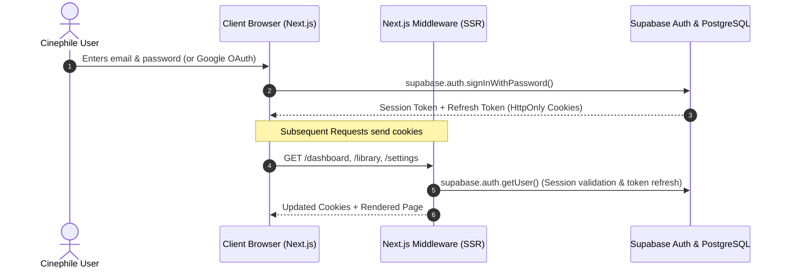

# CINEASTE — Authentication, Authorization & Security Audit

**Document:** `CINEASTE_AUTH_SECURITY_AUDIT.md`  
**Project Path:** `D:\CINEASTE-INDEPENDENT`  
**Date:** November 12, 2026  
**Auditor:** Senior Security Engineer & Backend Architect  

---

## 1. Authentication Architecture

Cineaste implements an enterprise-grade authentication system using Supabase Auth with PKCE flow and `@supabase/ssr` cookie session management:



---

## 2. Row Level Security (RLS) Policy Audit

All 13 database tables are protected with strict Row Level Security. Every table has `ALTER TABLE ... ENABLE ROW LEVEL SECURITY;` executed in migration 02.

### Detailed Table Policy Matrix

| Table | Operation | Policy Enforcement Expression | Security Outcome |
| :--- | :--- | :--- | :--- |
| `public.profiles` | `SELECT` | `auth.uid() = id OR public.is_profile_public(id) OR public.is_admin()` | Profile visible to owner, admins, or if user explicitly enabled public profile visibility. |
| `public.profiles` | `UPDATE` | `auth.uid() = id` (WITH CHECK `auth.uid() = id`) | Users can only modify their own profile details. |
| `public.user_preferences` | `SELECT` | `auth.uid() = user_id OR public.is_admin()` | **Zero Leakage:** Private preferences (emails, regions, notifications) are never visible to other users. |
| `public.user_preferences` | `ALL` | `auth.uid() = user_id` | Full control strictly for the owning user. |
| `public.user_roles` | `SELECT` | `auth.uid() = user_id OR public.is_admin()` | Users can read their own role. |
| `public.user_roles` | `INSERT/UPDATE/DELETE` | `public.is_admin()` | **Privilege Escalation Defense:** Only verified admins can write to roles. Regular users cannot self-promote. |
| `public.movies` | `SELECT` | `true` (Publicly readable) | Shared catalog cache is readable by all users. |
| `public.movies` | `INSERT/UPDATE` | `auth.role() = 'authenticated' OR public.is_admin()` | Authenticated users can cache movies from TMDB; deletion restricted to admins. |
| `public.user_movies` | `SELECT` | `auth.uid() = user_id OR public.is_watchlist_public(user_id) OR public.is_admin()` | Private watchlist isolation. Other users cannot view unless explicitly shared. |
| `public.user_movies` | `INSERT` | `auth.uid() = user_id` | Users can only add films to their own library vault. |
| `public.user_movies` | `UPDATE/DELETE` | `auth.uid() = user_id` | **Cross-Tenant Mutation Defense:** Users cannot alter or delete another user's ratings, reviews, or status. |
| `public.collections` | `SELECT` | `auth.uid() = user_id OR is_public = true OR public.is_admin()` | Collections are private to the owner unless marked `is_public = true`. |
| `public.collections` | `INSERT/UPDATE/DELETE`| `auth.uid() = user_id` | Only collection owner can edit or delete collections. |
| `public.collection_movies` | `ALL` | `EXISTS (SELECT 1 FROM public.collections c WHERE c.id = collection_id AND c.user_id = auth.uid())` | **Nested Ownership Enforcement:** Users cannot inject or delete movies from collections they do not own. |
| `public.movie_activities` | `SELECT` | `auth.uid() = user_id OR public.is_activity_public(user_id) OR public.is_admin()` | Timeline diary is private to the owner unless activity sharing is enabled. |
| `public.movie_activities` | `INSERT/UPDATE/DELETE`| `auth.uid() = user_id` | Users cannot forge timeline entries for other accounts. |
| `public.user_subscriptions`| `SELECT` | `auth.uid() = user_id OR public.is_admin()` | Users can view their own subscription tier. |
| `public.user_subscriptions`| `INSERT/UPDATE/DELETE`| `public.is_admin()` (or Service Role) | **Plan Tampering Defense:** Regular users cannot update plan from Free to Pro/Premium directly. |

---

## 3. Storage Security & Path Traversal Defense

The `avatars` bucket in Supabase Storage (`supabase/migrations/20261031_03_storage_buckets.sql`) implements folder-level user isolation:

1. **Path Prefix Enforcement:**
   ```sql
   (storage.foldername(name))[1] = auth.uid()::text
   ```
2. **Dual Validation on Updates:**
   - Both the old row (`USING`) and new row (`WITH CHECK`) must match `auth.uid()`.
   - Prevents moving files into another user's directory.
3. **File Size & MIME Type Whitelisting:**
   - Max file size: 5,242,880 bytes (5 MB).
   - Allowed MIME types: `image/png`, `image/jpeg`, `image/webp`, `image/gif`.

---

## 4. API Authorization & Protected Routes

### A. Admin Endpoints (`/api/admin/action`, `/api/admin/metrics`)
1. **Session Authentication:** Reads user from session cookies using `createClient()`.
2. **Database Role Verification:** Directly queries `public.user_roles` for `role = 'admin'` using the authenticated user's verified ID.
3. **Audit Logging:** Every administrative action (`update_role`, `publish_announcement`, `toggle_feature_flag`) is written to `public.admin_audit_logs`.
4. **Zero Frontend Trust:** Manipulating client-side React state (`isAdmin: true`) has zero effect on API authorization. The server independently verifies the database role.

### B. TMDB Gateway (`/api/tmdb`)
- Server-side proxy keeps upstream credentials completely off client devices.
- Request parameters sanitized and validated.
- Rate-limiting mitigated via 15-minute in-memory cache.

---

## 5. Security Checklist & Vulnerability Assessment

- [x] **SQL Injection:** Zero raw string concatenation. All Supabase queries use parameterized PostgREST interfaces.
- [x] **XSS Prevention:** React JSX escapes rendered strings by default. Dangerous HTML is never injected.
- [x] **CSRF Defense:** Cookie-based session validation combined with SameSite cookie attributes via `@supabase/ssr`.
- [x] **Privilege Escalation:** Roles stored in independent table `user_roles`; client writes blocked by RLS.
- [x] **Search Path Hijacking:** All `SECURITY DEFINER` functions specify `SET search_path = public, pg_temp`.
- [x] **Secret Exposure:** `SUPABASE_SERVICE_ROLE_KEY` used exclusively in server-side functions and never leaked to browser bundles.
