# CINEASTE — Comprehensive Database Architecture Specification

**Document:** `CINEASTE_DATABASE_ARCHITECTURE.md`  
**Project Path:** `D:\CINEASTE-INDEPENDENT`  
**Database Engine:** PostgreSQL 15+ (Supabase)  
**Date:** November 12, 2026  
**Architect:** Senior Database Architect & Backend Engineer  

---

## 1. Architectural Principles & Relational Model

The Cineaste database architecture separates **public shared cinematic metadata** from **private tenant vault records**:
1. **Shared Catalog Cache (`public.movies`)**: Keyed uniquely on `tmdb_id` (TMDB's canonical integer identifier). Movie metadata is stored once and shared across all users, preventing redundant duplicate storage.
2. **User Vault Isolation (`public.user_movies`)**: Contains user-specific states (`want`, `watching`, `watched`, `dropped`), personal ratings (0.5 to 10.0), reviews, screening dates, and favorites. A compound unique constraint `(user_id, tmdb_id)` strictly prohibits duplicate entries for the same film.
3. **Dedicated Role & Privilege Separation (`public.user_roles`)**: User roles (`admin`, `user`) are segregated from public profiles into an independent table governed strictly by `SECURITY DEFINER` procedures, completely preventing client-side privilege escalation.
4. **Subscription Plan Integrity (`public.user_subscriptions`)**: Stores tier (`free`, `pro`, `premium`), status, and Stripe references. Modifications are strictly restricted to service-role processes (Stripe webhooks) and verified admins.

---

## 2. Entity-Relationship Diagram

```mermaid
erDiagram
    auth_users ||--|| profiles : "1:1 identity"
    auth_users ||--|| user_preferences : "1:1 config"
    auth_users ||--|| user_roles : "1:1 permissions"
    auth_users ||--|| user_subscriptions : "1:1 billing"
    auth_users ||--o{ user_movies : "owns library"
    auth_users ||--o{ collections : "curates shelves"
    auth_users ||--o{ movie_activities : "logs journey"
    auth_users ||--o{ admin_audit_logs : "records actions"

    movies ||--o{ user_movies : "cataloged by users"
    movies ||--o{ collection_movies : "grouped into collections"
    movies ||--o{ movie_activities : "referenced in events"

    collections ||--o{ collection_movies : "contains films"

    profiles {
        uuid id PK "references auth.users(id)"
        text username UK "unique cinephile handle"
        text display_name "full name"
        text avatar_url "storage bucket URL"
        text bio "personal biography"
        text region "default streaming region"
        text language "preferred UI language"
        timestamptz created_at
        timestamptz updated_at
    }

    user_preferences {
        uuid user_id PK "references auth.users(id)"
        text theme "dark | light | system"
        text accent_color "emerald | crimson | etc"
        text interface_density "comfortable | compact"
        boolean autoplay_trailers
        text rating_system "stars5 | ten | thumbs"
        text streaming_region "IN | US | GB | etc"
        text profile_visibility "private | friends | public"
        boolean show_activity
        boolean show_watchlist
        timestamptz local_migrated_at
        timestamptz updated_at
    }

    user_roles {
        uuid user_id PK "references auth.users(id)"
        text role "user | admin"
        timestamptz created_at
    }

    movies {
        uuid id PK "gen_random_uuid()"
        integer tmdb_id UK "canonical TMDB ID"
        text title "film title"
        text original_title
        text overview
        text poster_path
        text backdrop_path
        text release_date
        integer runtime "duration in minutes"
        numeric vote_average "3.1 precision"
        integer vote_count
        jsonb genres "structured genre list"
        timestamptz metadata_updated_at
    }

    user_movies {
        uuid id PK
        uuid user_id FK "references auth.users(id)"
        uuid movie_id FK "references public.movies(id)"
        integer tmdb_id "direct lookup"
        text status "want | watching | watched | dropped"
        boolean is_favorite
        numeric personal_rating "0.5 to 10.0"
        text review "personal notes & review"
        text watched_date "ISO date of screening"
        timestamptz added_at
        timestamptz updated_at
    }

    collections {
        uuid id PK
        uuid user_id FK "references auth.users(id)"
        text name "shelf title"
        text description
        text color "hex accent color"
        boolean is_public "sharing status"
        text cover_url
        timestamptz created_at
        timestamptz updated_at
    }

    collection_movies {
        uuid id PK
        uuid collection_id FK "references public.collections(id)"
        uuid movie_id FK "references public.movies(id)"
        integer tmdb_id
        integer position "custom order index"
        timestamptz added_at
    }

    movie_activities {
        uuid id PK
        uuid user_id FK "references auth.users(id)"
        uuid movie_id FK "references public.movies(id)"
        integer tmdb_id
        text activity_type "added | watched | viewed"
        timestamptz occurred_at
        jsonb metadata
        timestamptz created_at
    }

    user_subscriptions {
        uuid id PK
        uuid user_id UK "references auth.users(id)"
        text provider "stripe"
        text provider_customer_id
        text provider_subscription_id
        text plan "free | pro | premium"
        text status "active | canceled | past_due | trialing"
        timestamptz current_period_start
        timestamptz current_period_end
        boolean cancel_at_period_end
        timestamptz created_at
        timestamptz updated_at
    }
```

---

## 3. Table Schema & Constraints Inventory

### 1. `public.profiles`
- **Primary Key:** `id` (UUID references `auth.users(id)` ON DELETE CASCADE).
- **Unique Constraints:** `username` (indexed, lower-cased handle).
- **Defaults:** `member_since` (`to_char(CURRENT_DATE, 'FMMonth YYYY')`), `preferred_genres` (`['Drama', 'Sci-Fi', 'Thriller']`), `region` (`'IN'`).
- **Triggers:** `trigger_set_updated_at_profiles` calls `public.set_updated_at()`.

### 2. `public.user_preferences`
- **Primary Key:** `user_id` (UUID references `auth.users(id)` ON DELETE CASCADE).
- **Constraints:** `chk_user_preferences_visibility` validates `profile_visibility IN ('private', 'friends', 'public')`.
- **Defaults:** `theme = 'dark'`, `accent_color = 'emerald'`, `interface_density = 'comfortable'`.
- **Triggers:** `trigger_set_updated_at_user_preferences`.

### 3. `public.user_roles`
- **Primary Key:** `user_id` (UUID references `auth.users(id)` ON DELETE CASCADE).
- **Constraints:** `chk_user_roles_role` validates `role IN ('user', 'admin')`.
- **Defaults:** `role = 'user'`.
- **Security:** RLS restricts writes strictly to `public.is_admin()`.

### 4. `public.movies`
- **Primary Key:** `id` (UUID `gen_random_uuid()`).
- **Unique Constraints:** `tmdb_id` (Integer, non-null).
- **Indexes:** `idx_movies_tmdb_id` on `tmdb_id`, `idx_movies_title` on `title`.
- **Triggers:** `trigger_set_movies_metadata_updated_at` calls `public.set_movies_metadata_updated_at()`.

### 5. `public.user_movies`
- **Primary Key:** `id` (UUID).
- **Foreign Keys:**
  - `user_id` references `auth.users(id)` ON DELETE CASCADE.
  - `movie_id` references `public.movies(id)` ON DELETE CASCADE.
- **Unique Constraints:** `uq_user_movie UNIQUE (user_id, tmdb_id)`. Prevents accidental duplicate saves.
- **Constraints:** `chk_user_movies_status` validates `status IN ('want', 'watching', 'watched', 'dropped')`.
- **Indexes:** `(user_id)`, `(user_id, status)`, `(user_id, is_favorite)`.
- **Triggers:** `trigger_set_updated_at_user_movies`.

### 6. `public.collections` & `public.collection_movies`
- **`collections` Primary Key:** `id` (UUID).
- **`collections` Foreign Key:** `user_id` references `auth.users(id)` ON DELETE CASCADE.
- **`collection_movies` Unique:** `uq_collection_movie UNIQUE (collection_id, movie_id)`.
- **Indexes:** `idx_collections_user_id`, `idx_col_movies_collection`, `idx_col_movies_position`.

### 7. `public.movie_activities` (Timeline Diary)
- **Primary Key:** `id` (UUID).
- **Foreign Keys:** `user_id` references `auth.users(id)` ON DELETE CASCADE; `movie_id` references `public.movies(id)` ON DELETE SET NULL.
- **Constraints:** `chk_movie_activities_type` validates `activity_type IN ('viewed', 'added', 'watched')`.
- **Indexes:** `idx_activities_user_timeline` on `(user_id, occurred_at DESC)`.

### 8. `public.user_subscriptions`
- **Primary Key:** `id` (UUID).
- **Unique Constraints:** `user_id` (UUID references `auth.users(id)` ON DELETE CASCADE).
- **Constraints:** `chk_user_subscriptions_plan` (`free`, `pro`, `premium`); `chk_user_subscriptions_status` (`active`, `canceled`, `past_due`, `trialing`).
- **Security:** RLS restricts updates strictly to service role and platform administrators.

---

## 4. Migration Execution & Verification Plan

All four migrations are located in `supabase/migrations/` and have been audited for zero-defect, non-destructive execution:

1. `20261031_01_initial_schema.sql`: Base tables, extensions, constraints, and `handle_new_user()` trigger.
2. `20261031_02_rls_policies.sql`: Row Level Security policies, `is_admin()`, and visibility functions.
3. `20261031_03_storage_buckets.sql`: Avatars storage bucket and object isolation policies.
4. `20261031_04_subscriptions.sql`: Subscription records, plan constraints, and automatic tier provisioning.

### Execution Safety Checklist
- [x] All table creations use `CREATE TABLE IF NOT EXISTS`.
- [x] All column additions use `ALTER TABLE ... ADD COLUMN IF NOT EXISTS`.
- [x] All policies are preceded by `DROP POLICY IF EXISTS`.
- [x] All triggers are preceded by `DROP TRIGGER IF EXISTS`.
- [x] Foreign keys use `ON DELETE CASCADE` or `ON DELETE SET NULL` to preserve referential integrity.
- [x] Triggers are bound to database events, eliminating client-side race conditions.
