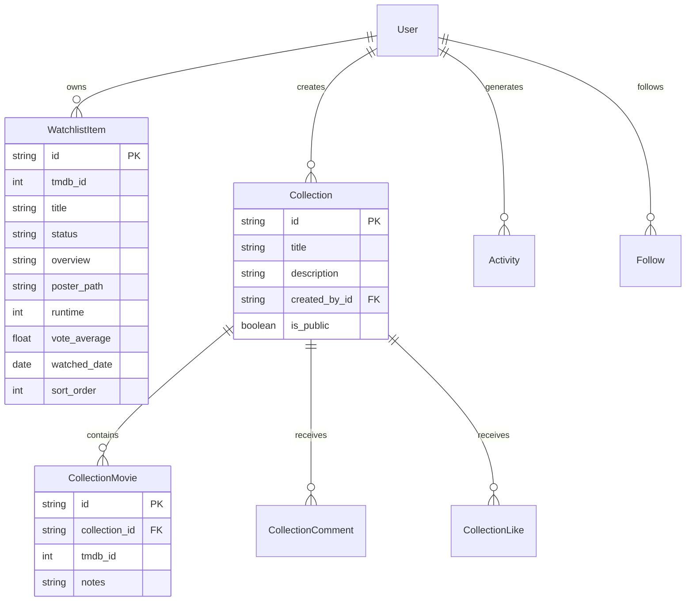

  

  # Cineaste
  
  **Your Second Brain for Movies**

  *A cinematic movie discovery and personal film-organizing platform.*

  
  

---

## 🎬 Project Overview

**Cineaste** is a modern movie discovery and personal film-organizing application built to solve recommendation overload. Designed as a "second brain" for cinema enthusiasts, Cineaste enables users to capture movie recommendations discovered across the web, structure them into custom thematic collections, track viewing history, and decide what to watch next with zero friction.

### 🔗 Live Application
Experience the live application deployed at:  
👉 **[https://eminent-cine-vault-flow.base44.app](https://eminent-cine-vault-flow.base44.app)**

---

## 🖼️ Visual Identity & Showcase

  
  
<em>Cinematic visual styling tailored for film lovers — deep dark theme (<code>#0A0B0F</code>) paired with vibrant emerald accents (<code>#00D664</code>).</em>

---

## ✨ Verified Features & Capabilities

The following features and workflows are implemented and verified in the live application:

- **Universal Movie Discovery (`/discover`)**:
  - Integrated search engine powered by The Movie Database (TMDB).
  - Search across titles, directors, cast members, genres, and release eras.
  - Detailed movie pages (`/movie/:id`) displaying official trailers, cast, runtime, synopsis, and high-resolution posters.

- **Intelligent Watchlist Tracking (`/watchlist`, `/watched`)**:
  - Categorization into active *Want to Watch* and *Watched* lists.
  - Custom sort orders, priority ranking, and viewing date stamps.
  - Personal reviews, star ratings, and watch reminders.

- **Thematic Collections (`/collections`, `/collections/:id`)**:
  - Custom curated film collections with descriptions and custom covers.
  - Smart collections and filtering by genre, decade, or mood.
  - Social collaboration hooks including collection likes, comments, and votes.

- **Letterboxd Data Migration (`/import`)**:
  - Built-in data import interface allowing users to migrate existing watchlists, ratings, and diary archives from Letterboxd directly into Cineaste.

- **Viewing Timeline & Activity (`/timeline`, `/dashboard`)**:
  - Personal cinema history timeline logging when films were watched.
  - Activity feed documenting additions, status transitions, and ratings.

- **User Accounts & Preferences (`/profile`, `/settings`)**:
  - Multi-user authentication with profile management and social follow mechanics.
  - Mobile-responsive navigation and installable Web App (PWA) manifest configuration.

---

## 🛠️ Verified Technology Stack

| Layer | Technologies | Verification Details |
| :--- | :--- | :--- |
| **Frontend Framework** | **React 18** (SPA) | Verified via client bundle architecture |
| **Routing** | **React Router DOM** | Verified client-side routes (`/discover`, `/watchlist`, `/collections`, etc.) |
| **State & Data Fetching** | **TanStack Query** (`@tanstack/react-query`) | Query caching, invalidation, and optimistic mutations |
| **Styling & UI Components** | **Tailwind CSS**, **Radix UI Primitives** | Modern dark cinematic theme (`#0A0B0F`), accessible modal & dropdown primitives |
| **Icons & Notifications** | **Lucide React**, **Sonner** | Clean vector iconography and reactive toast feedback |
| **External APIs** | **The Movie Database (TMDB) API** | Real-time metadata, cast details, trailer embeds, and artwork CDN (`image.tmdb.org`) |
| **Platform Infrastructure** | **Base44 Cloud** | Managed application container, real-time entity persistence, and edge hosting |

---

## 📊 Data Model & Entity Architecture

Inspection of the application runtime confirms the following core entity relationships:

---

## 📦 Source Code Status

> [!IMPORTANT]
> **Source Code Export Pending**  
> Cineaste was built, authored, and deployed on the **Base44** application platform. Because the current workspace plan restricts one-click source archive downloads, the full local React source tree (uncompiled components, backend edge handlers, and configuration manifests) is currently pending an export transition.
>
> To maintain complete engineering honesty and avoid fabricating synthetic code, this repository serves as the official **Project Showcase, Design System, Architecture Specification, and Live Portal**.
>
> The complete application is fully operational and publicly testable on the live deployment:  
> 🔗 **[https://eminent-cine-vault-flow.base44.app](https://eminent-cine-vault-flow.base44.app)**

---

## 🚀 Roadmap & Next Steps

- [ ] Complete full source extraction via developer export tools or Git synchronization.
- [ ] Establish standalone local build environment (`vite`, `npm run dev`).
- [ ] Two-way automated sync with Letterboxd and Trakt.tv.
- [ ] AI-assisted natural language movie discovery ("find me a 90s mystery set in a rainy city").
- [ ] Push notifications for theatrical and streaming release dates on user watchlists.

---

## 📄 License

This project documentation and assets are released under the [MIT License](LICENSE).
