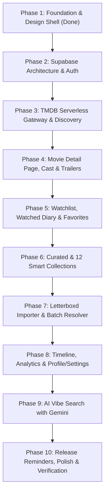

# Cineaste — Complete Migration Gap Analysis & Reconstruction Blueprint

**Target Workspace:** `D:\CINEASTE-INDEPENDENT`  
**Original Live Application:** [https://eminent-cine-vault-flow.base44.app](https://eminent-cine-vault-flow.base44.app)  
**Live Production Bundle Analyzed:** `assets/index-Cj7Dk6LH.js` (1.53 MB) & `assets/index-XuFztMFu.css` (83.8 KB)  
**Date:** October 2026  
**Status:** Gap Analysis Complete — Awaiting Approval for Implementation Sequence

---

## 1. Executive Summary & Objective Realignment

This document establishes the technical audit and migration gap analysis between the **original live Base44 Cineaste application** and the **Phase 1 foundation currently built inside `D:\CINEASTE-INDEPENDENT`**.

### The Real Objective
The goal of this project is **not** to create an "inspired" generic movie app. The goal is to perform a **faithful 1:1 reconstruction and platform migration** of the existing Cineaste application from Base44 into an independent, production-grade Next.js 15 application. 

Every visual treatment, layout convention, user journey, modal dialog, and interaction from the original application must be faithfully preserved, while Base44's proprietary runtime is cleanly replaced with independent open standards (Next.js server route handlers, Supabase PostgreSQL with RLS, Google Gemini API, and TMDB v3 API).

---

## 2. Classification Criteria

Each original page and feature is classified into one of five rigorous status categories:

1. **Fully Reproduced:** The exact visual layout, data bindings, client interactions, and responsive behaviors are fully built and tested in `D:\CINEASTE-INDEPENDENT`.
2. **Partially Reproduced:** Visual tokens, design shells, or stubs exist, but complete page-level views, interactions, data wiring, or state management remain incomplete.
3. **Not Implemented:** Feature or page exists in the original Base44 application but has not yet been constructed in `D:\CINEASTE-INDEPENDENT`.
4. **Cannot Be Verified from Public Website:** Private backend logic, internal admin consoles, or server-only hooks whose client traces exist in the bundle but whose full server-side behavior cannot be inspected over the wire.
5. **Requires Independent Backend Implementation:** Proprietary Base44 server functions (`functions.invoke`) or built-in integrations (`integrations.Core.*`) that must be re-architected cleanly from scratch using modern serverless standards.

---

## 3. Master Page & Feature Gap Matrix

| Original Route | Component ID | Page / Feature Description | Migration Classification | Current Status in D:\CINEASTE-INDEPENDENT |
| :--- | :--- | :--- | :--- | :--- |
| `/` | `Landing` | Public landing page with hero banner, prompt pills, feature showcase, and watchlist teaser | **Partially Reproduced** | Visual shell, design tokens, and showcase grid created in `src/app/page.tsx`. Needs exact original copy, marketing sections, and unauthenticated landing state. |
| `/dashboard` | `Lbe` | User dashboard: Watched stats, runtime hours, average rating, top genres, Currently Watching carousel, Recent Activity feed, and Curated Shelves | **Not Implemented** | Route does not exist yet. Only static stats card mockup exists on `page.tsx`. |
| `/discover` | `r0e` | Universal discovery: Title search vs. AI Vibe Search toggle, 19 TMDB genre pills carousel, weekly trending carousel, year/score filters, and movie grid with user watchlist cross-referencing | **Partially Reproduced** | Static genre pills and sample movie cards exist on home showcase. Dedicated `/discover` page, query state (`q`, `ai`), live TMDB fetching, and AI vibe translation are **Not Implemented**. |
| `/movie/:id` | `v0e` | Full film detail: High-res backdrop hero, trailer modal, 10-point/5-star rating widget, Want/Watched/Favorite toggles, Add to Collection modal, Cast & Crew reel, JustWatch streaming providers, and Similar films | **Not Implemented** | Dynamic route `src/app/movie/[id]/page.tsx` does not exist. Only poster card representation exists in `src/components/ui/movie-card.tsx`. |
| `/watchlist` | `N0e` | Watchlist ("Want to Watch"): Grid/List view toggle (`wl_view`), multi-factor filters (genre, decade, runtime `<90m`/`>120m`, min rating, favorites), sort orders, custom reminder picker (`remind_on`) | **Not Implemented** | Route does not exist. No local storage view persistence or filter drawer built. |
| `/watched` | `C0e` | Watched history diary: Chronological log of viewed films, user ratings, viewing dates (`watched_date`), personal reviews, and empty state | **Not Implemented** | Route does not exist. |
| `/favorites` | `P0e` | Favorites showcase: Filtered gallery of films flagged with `is_favorite = true` with heart animation and sharing | **Not Implemented** | Route does not exist. |
| `/collections` | `T0e` | Curated collections index: User collection cards, 12 smart collection cards, and Create Collection modal with 8-color palette picker | **Not Implemented** | Route does not exist. |
| `/collections/:id` | `PNe` | Collection detail: Banner with custom color, movie list with personal notes, movie reordering, search & add modal, like counter, and comment thread | **Not Implemented** | Route does not exist. Requires independent database relationships for collection items, likes, and comments. |
| `/collections/smart/:slug` | `kNe` | 12 automated algorithmic collections (`action`, `comedy`, `scifi`, `mind-bending`, `horror`, `drama`, `animation`, `romance`, `family`, `weekend`, `top-rated`, `classics`) matching user library | **Not Implemented** | Slugs verified in bundle. Route and algorithmic matching functions not yet implemented. |
| `/import` | `$Ne` | Letterboxd CSV/ZIP importer: Client-side header detection (`ratings`, `watched`, `watchlist`, `lists`), title+year batch TMDB resolver, progress bar, conflict resolution table, and batch insert | **Not Implemented** | Parser algorithms verified in bundle. Route, drag-and-drop zone, resolver, and batch insertion not yet built. |
| `/timeline` | `BNe` | Cinema timeline: Chronological timeline of user activities (watched, added, favorited, rated, reviewed, collection created) grouped by year and month | **Not Implemented** | Route does not exist. |
| `/profile` | `WNe` | User profile editor: Display name, handle, bio, avatar URL, favorite genres multi-select, and Letterboxd username sync | **Not Implemented** | Route does not exist. |
| `/u/:userId` | `PublicProfile` | Public member profile: Public watch history, favorites, curated collections, and user stats | **Not Implemented** | Route does not exist. |
| `/settings` | `VNe` | App settings: Rating system (`stars5` vs `stars10`), autoplay trailers toggle, streaming region (`IN`, `US`, etc.), UI density, and notification preferences | **Not Implemented** | Route does not exist. |
| `/notifications` | `GNe` | Release date notifications: Upcoming cinema/streaming release alerts (`remind_on` matching), mark read, and manual trigger | **Not Implemented** | Route does not exist. |
| `/billing` | `iBe` | Stripe subscription checkout & customer billing portal for Cineaste Pro | **Not Implemented** | Route does not exist. |
| `/login` | `Auth` | Dark-themed email/password authentication with redirection | **Not Implemented** | Route does not exist. |
| `/register` | `Auth` | New user signup with automatic profile generation trigger | **Not Implemented** | Route does not exist. |
| `/forgot-password` | `Auth` | Password recovery request form | **Not Implemented** | Route does not exist. |
| `/reset-password` | `Auth` | Password reset completion form | **Not Implemented** | Route does not exist. |
| `/legal/:doc` | `Legal` | Markdown renderer for Terms of Service and Privacy Policy | **Not Implemented** | Route does not exist. |
| `/admin` | `Admin` | Internal platform management & announcements | **Cannot Be Verified from Public Website** | Client references exist in bundle; backend permissions are private to Base44. |

---

## 4. Granular Component & Interaction Discrepancy Breakdown

### 4.1 Navigation & Global App Shell

| Feature | Original Base44 Implementation | Current D:\CINEASTE-INDEPENDENT Implementation | Status / Action Needed |
| :--- | :--- | :--- | :--- |
| **Brand Identity** | Emerald Clapper icon + "CINEASTE Film Vault" in Sora bold with `#00D664` accent | Preserved in `sidebar.tsx` and `top-nav.tsx` using exact hex `#0A0B0F`, `#00D664`, and `#F3F4F6` | **Fully Reproduced** |
| **Desktop Left Sidebar** | Fixed left navigation with Explore, Library, and Tools groups; active route pill with glow; user footer slot | Fully built in `src/components/layout/sidebar.tsx` with active pathname matching | **Fully Reproduced** |
| **Top Navigation Bar** | Search pill trigger (`Cmd+K` / `Ctrl+K`), "+ Add Movie" button, notification bell badge, user profile avatar | Built in `src/components/layout/top-nav.tsx` | **Fully Reproduced** |
| **Mobile Bottom Bar** | Fixed bottom nav (`md:hidden`) with 5 core tabs (Dashboard, Discover, Watchlist, Watched, Collections) | Built in `src/components/layout/mobile-nav.tsx` with safe-area support | **Fully Reproduced** |
| **Command Palette (`Cmd+K`)** | Global modal search with keyboard navigation (`↑↓`, `↵`, `ESC`), vibe suggestions, recent history, and live movie results | Visual structure and mock data built in `command-palette.tsx`. **Needs wiring to live TMDB search**. | **Partially Reproduced** |

---

### 4.2 Discovery & AI Vibe Engine (`/discover`)

| Feature | Original Base44 Implementation | Current D:\CINEASTE-INDEPENDENT Implementation | Status / Action Needed |
| :--- | :--- | :--- | :--- |
| **Dual Search Modes** | Toggle button switching between standard keyword title search and conversational AI Vibe Search | Not implemented as a page. Preview pills exist on home showcase. | **Not Implemented** |
| **URL State Synchronization** | Reads/writes `?q=...` and `?ai=1` to browser URL history for bookmarking and shareable search links | Not implemented. | **Not Implemented** |
| **AI Vibe Translation** | Calls `Core.InvokeLLM` with prompt: *"You translate a user's natural language movie description into TMDB discover criteria..."* returning structured genres, years, and interpretation | Requires an independent Next.js server route `/api/ai/vibe` using Google Gemini API. | **Requires Independent Backend Implementation** |
| **19 TMDB Genre Carousel** | Horizontal scrollable badge carousel with emerald active states | Built visually as a component in `page.tsx` and `badge.tsx`. Needs connection to real TMDB discover query. | **Partially Reproduced** |
| **Trending Reel** | Weekly trending movie carousel (`/trending/movie/week`) rendered above search results when query is empty | Not implemented. | **Not Implemented** |
| **User Status Badges** | Each movie in the discovery grid checks user's library and shows if it's already "In Watchlist", "Watched", or "Favorited" | MovieCard supports status props, but client library cross-referencing state is not wired. | **Partially Reproduced** |

---

### 4.3 Movie Detail View (`/movie/:id`)

| Feature | Original Base44 Implementation | Current D:\CINEASTE-INDEPENDENT Implementation | Status / Action Needed |
| :--- | :--- | :--- | :--- |
| **Backdrop Hero Banner** | 16:9 high-res backdrop with dark obsidian gradient fade, movie title in Sora bold, release year, runtime, certification, and director | Not implemented. | **Not Implemented** |
| **Trailer Player Modal** | Responsive embedded YouTube video player querying TMDB `/movie/{id}/videos` for official trailer key | Not implemented. | **Not Implemented** |
| **Interactive Rating Widget** | Configurable 10-point scale or 5-star scale (with half-stars) with immediate database mutation | Not implemented. | **Not Implemented** |
| **Status Switcher** | Segmented control / dropdown: Want to Watch, Watched, Watching, Dropped, or Not on List | Button stubs exist on MovieCard hover overlay, but detail page segmented control is missing. | **Not Implemented** |
| **Add to Collection Modal** | Modal displaying user's collections with checkboxes, plus inline "Create Collection" input | Not implemented. | **Not Implemented** |
| **Cast & Crew Reel** | Horizontal scrollable reel of top billed cast with photo, actor name, and character name | Not implemented. | **Not Implemented** |
| **Where to Watch** | Displays JustWatch streaming providers (Netflix, Prime, Max, etc.) based on user's selected country code | Not implemented. | **Not Implemented** |
| **Similar & Recommended** | TMDB `/movie/{id}/similar` carousel allowing one-click navigation to related films | Not implemented. | **Not Implemented** |

---

### 4.4 Watchlist, Watched History & Favorites

| Feature | Original Base44 Implementation | Current D:\CINEASTE-INDEPENDENT Implementation | Status / Action Needed |
| :--- | :--- | :--- | :--- |
| **View Mode Toggle** | Toggle between Poster Grid and Detailed List view, persisted in `localStorage("wl_view")` | Not implemented. | **Not Implemented** |
| **Multi-Filter Drawer** | Filter by: Genre, Release Decade, Runtime (`<90m`, `90-120m`, `>120m`), Minimum Rating, and Favorites only | Not implemented. | **Not Implemented** |
| **Sorting Engine** | Sort by: Date Added (`created_at`), Release Date (`release_date`), Title (`title`), or TMDB Score (`vote_average`) | Not implemented. | **Not Implemented** |
| **Release Reminders** | `remind_on` date picker allowing users to set upcoming cinema or streaming alert dates | Not implemented. | **Not Implemented** |
| **Watched Diary** | Chronological viewing diary with viewing date (`watched_date`), star rating, and personal text review | Not implemented. | **Not Implemented** |
| **Favorites Filter** | Instant filtered view of all library entries where `is_favorite = true` | Not implemented. | **Not Implemented** |

---

### 4.5 Thematic Curated & Smart Collections

| Feature | Original Base44 Implementation | Current D:\CINEASTE-INDEPENDENT Implementation | Status / Action Needed |
| :--- | :--- | :--- | :--- |
| **Curated Collections CRUD** | Create custom collections with title, description, cover image upload, and custom accent color | Not implemented. | **Not Implemented** |
| **Color Palette Picker** | 8 preset accent colors (`#FF4D5A`, `#6366F1`, `#22C55E`, `#F59E0B`, `#06B6D4`, `#EC4899`, `#8B5CF6`, `#00D664`) | Not implemented. | **Not Implemented** |
| **Movie Notes & Reordering** | Personal note per film in a collection and custom `sort_order` reordering | Not implemented. | **Not Implemented** |
| **12 Smart Collections** | Automated dynamic shelves: `action`, `comedy`, `scifi`, `mind-bending`, `horror`, `drama`, `animation`, `romance`, `family`, `weekend`, `top-rated`, `classics` | Not implemented. | **Not Implemented** |
| **Collection Socials** | Likes counter (`collection_likes`) and public comment thread (`collection_comments`) with real-time updates | Not implemented. | **Requires Independent Backend Implementation** |

---

### 4.6 Letterboxd Migration Engine (`/import`)

| Feature | Original Base44 Implementation | Current D:\CINEASTE-INDEPENDENT Implementation | Status / Action Needed |
| :--- | :--- | :--- | :--- |
| **Multi-File Drag & Drop** | Supports multiple CSV files or ZIP archives simultaneously | Not implemented. | **Not Implemented** |
| **Auto-Header Detection** | Identifies `ratings.csv` (contains `rating`), `watched.csv` (contains `date`), `watchlist.csv` (contains `position`), and custom lists (contains `description`) | Algorithm reverse-engineered in `INSPECTION_REPORT.md`; UI not yet built. | **Not Implemented** |
| **Batch TMDB Resolver** | Queries TMDB with title + release year constraint to accurately map Letterboxd entries to TMDB IDs | Not implemented. | **Not Implemented** |
| **Conflict & Preview Table** | Displays matched poster, resolved title, year, parsed rating, and duplicate indicator before database insertion | Not implemented. | **Not Implemented** |
| **Batch Persistence** | Inserts all validated records into `watchlist_items` and creates corresponding `activities` | Not implemented. | **Requires Independent Backend Implementation** |

---

### 4.7 Timeline, Profile & Settings

| Feature | Original Base44 Implementation | Current D:\CINEASTE-INDEPENDENT Implementation | Status / Action Needed |
| :--- | :--- | :--- | :--- |
| **Visual Timeline** | Chronological feed of user activity (`added`, `watched`, `rated`, `reviewed`, `collection_created`) grouped by year and month | Not implemented. | **Not Implemented** |
| **Profile Management** | User avatar upload, display name, handle, bio, favorite genres multi-select, Letterboxd sync | Not implemented. | **Not Implemented** |
| **Settings Preferences** | Rating scale (`stars5` vs `stars10`), autoplay trailers toggle, default streaming country (`IN`/`US`/etc.), density (`comfortable`/`compact`) | Not implemented. | **Not Implemented** |
| **Release Notifications** | Backend scan for films in watchlist with release date in next 14 days, sending email or in-app notification | Not implemented. | **Requires Independent Backend Implementation** |

---

## 5. Verified Original Implementation vs. Inferred Functionality

To maintain absolute technical integrity, we distinguish what was **directly verified** from the compiled bundle versus what must be **independently implemented**:

### 5.1 Definitively Verified from Bundle
1. **Routing Scheme:** All 25 routes, parameters (`:id`, `:slug`, `:doc`, `:userId`), and layouts.
2. **Design Tokens:** Exact HSL/Hex variables (`#0A0B0F`, `#101118`, `#1E1F2A`, `#00D664`, `#FBBF24`, `#F3F4F6`, `#9496A1`), font families (`Sora` and `Inter`), border radius (`0.85rem`), and chart color assignments.
3. **TMDB Proxy Actions:** `search`, `trending`, `discover`, `genres`, `details`, `person`, `trendingPeople`.
4. **AI Vibe Search Logic:** Genre mapping table (19 IDs) and prompt template extracting `with_genres`, `sort_by`, `from_year`, `to_year`, and `interpretation`.
5. **Letterboxd Parser Logic:** Header identification heuristics and CSV column extraction (`Name`, `Year`, `Rating`, `Date`).
6. **Smart Collection Presets:** The 12 exact slug identifiers and matching predicates.
7. **Entity Field Schemas:** `WatchlistItem`, `Collection`, `CollectionMovie`, `Activity`, `UserProfile`, `CollectionLike`, `CollectionComment`.

### 5.2 Proprietary Base44 Backend Services Requiring Independent Replacement
1. **`tmdbProxy` function:** In Base44, this ran on proprietary serverless workers. In Cineaste-Independent, this will be replaced with a Next.js App Router API route `src/app/api/tmdb/[...path]/route.ts` with server-side caching and API key security.
2. **`Core.InvokeLLM` integration:** In Base44, this used Base44's internal LLM router. In Cineaste-Independent, this will be replaced with `src/app/api/ai/vibe/route.ts` powered by the Google Gemini API with JSON schema enforcement.
3. **Base44 Database & Auth:** In Base44, this used proprietary entity ORM methods (`se.entities.*`). In Cineaste-Independent, this will be replaced with Supabase PostgreSQL (`@supabase/ssr`) with strict Row Level Security (RLS) policies.
4. **File Uploads (`Core.UploadPublicFile`):** In Base44, custom collection covers were uploaded via Base44 internal storage. In Cineaste-Independent, this will use Supabase Storage buckets (`avatars`, `collection-covers`).
5. **Release Reminders (`sendReleaseNotifications`):** In Base44, this was a scheduled background function. In Cineaste-Independent, this will be implemented via Next.js Cron or Supabase Edge Functions with Resend/Nodemailer.

---

## 6. End-to-End Migration Roadmap

The migration will be executed in clear, reviewable phases. Each phase will produce verifiable, working functionality without breaking existing Phase 1 foundations:

### Detailed Phase Specifications

#### Phase 2: Supabase Architecture, SSR Authentication & User Profiles
- Install `@supabase/supabase-js` and `@supabase/ssr`.
- Execute SQL migrations creating tables: `profiles`, `watchlist_items`, `collections`, `collection_movies`, `activities`, `collection_likes`, `collection_comments`.
- Implement Row Level Security (RLS) policies for complete user data isolation.
- Build authentication routes: `/login`, `/register`, `/forgot-password`, `/reset-password`.
- Implement Next.js auth middleware for protected route verification.

#### Phase 3: TMDB Serverless Gateway, Universal Discovery & Command Palette
- Build server-side route handler `/api/tmdb/[...path]/route.ts` with in-memory/edge caching (60s search, 1hr genres/details).
- Implement client TMDB client in `src/lib/tmdb.ts`.
- Build the full `/discover` page with keyword search, genre carousel, trending reel, year/score sliders, and layout view modes.
- Wire the global Command Palette (`Cmd+K`) to live TMDB search results with keyboard selection.

#### Phase 4: Movie Detail Page (`/movie/:id`), Cast & Trailer Modals
- Build dynamic route `src/app/movie/[id]/page.tsx`.
- Create cinematic backdrop hero with responsive gradient blending.
- Implement responsive YouTube trailer modal fetching TMDB video keys.
- Build Cast & Crew reel and JustWatch streaming provider displays.
- Implement action bar: Want to Watch, Watched, Favorites, 10-point / 5-star rating widget, and "Add to Collection" modal.

#### Phase 5: Watchlist, Watched History Diary & Favorites
- Build `/watchlist` with Grid/List view toggle (`localStorage` persistence).
- Build multi-filter drawer (genre, decade, runtime `<90m`/`>120m`, min rating, favorites).
- Build `/watched` viewing diary with date filter, user ratings, and personal reviews.
- Build `/favorites` filtered view.
- Ensure optimistic UI updates so status changes reflect immediately without page reloads.

#### Phase 6: Thematic Curated Collections & 12 Smart Collections
- Build `/collections` hub with collection creation modal and 8-color palette selector.
- Build `/collections/[id]` detail view with movie notes, drag-and-drop reordering, and public sharing toggle.
- Implement social likes and comments.
- Build `/collections/smart/[slug]` implementing the 12 verified smart collection algorithms against user data.

#### Phase 7: Letterboxd CSV/ZIP Importer & Batch Matching Engine
- Build `/import` page with multi-file drag-and-drop zone.
- Implement client-side parser detecting `ratings.csv`, `watched.csv`, `watchlist.csv`, and custom lists.
- Build batch TMDB resolver matching titles and release years with live progress indicator.
- Build preview/conflict table allowing users to review matches before confirming batch insert.
- Batch insert records into Supabase `watchlist_items` and `activities`.

#### Phase 8: Cinema Timeline, Activity Stream & User Settings
- Build `/timeline` aggregating user diary entries, additions, ratings, and collection creation events into year/month groups.
- Build `/profile` and `/settings` pages supporting rating scale toggle (`stars5` vs `stars10`), streaming country code, and Letterboxd username sync.
- Build `/notifications` displaying upcoming movie release alerts.

#### Phase 9: AI Vibe Search with Google Gemini API
- Build server route `/api/ai/vibe/route.ts` invoking Google Gemini 1.5 Flash.
- Enforce structured JSON output matching TMDB discover filters (`with_genres`, `sort_by`, `from_year`, `to_year`, `vote_count_gte`, `interpretation`).
- Wire the AI Vibe toggle on `/discover` and command palette prompts.

#### Phase 10: Bug Squashing, Mobile UX Polish & Production Verification
- Verify layout across mobile, tablet, and widescreen desktop.
- Comprehensive accessibility audit (focus trapping in modals, aria labels, keyboard navigation).
- End-to-end testing of Letterboxd import with sample user archives.
- Final production build check and deployment readiness.

---

## 7. Immediate Next Step: Awaiting User Approval

Per your instruction:
- **Phase 1 work has been strictly preserved** and remains intact.
- **No Phase 2 code or breaking changes have been initiated**.
- **Original Base44 website and external GitHub repository remain untouched**.

Please review this gap analysis and let me know if you approve this roadmap or would like to adjust the phase sequence before we begin **Phase 2: Supabase Architecture, SSR Authentication & User Profiles**.
